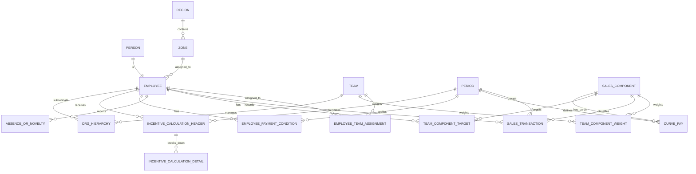

# Propuesta de diseño relacional simplificada

## 1. Objetivo

Definir una base de datos relacional capaz de soportar el cálculo, consulta, auditoría e historización de incentivos de Zambon, usando solo la estructura necesaria para que el sistema sea robusto sin sobrecarga innecesaria.

- Cargar ventas por empleado, periodo y componente.
- Calcular el componente mensual del 80%.
- Calcular el componente de ejecución del 20%.
- Manejar excepciones por equipo, jerarquía, antigüedad, cambio de zona y reglas de pago garantizado.
- Conservar históricos de parámetros por mes o ciclo.
- Permitir consultas por empleado, equipo, periodo, componente y nivel jerárquico.

La propuesta está basada en las estructuras observadas en `calculocomisiones.xlsx`: `Curve Pay`, `BASES`, `NOVEDADES`, hojas por fuerza/equipo y hojas de resumen.

## 2. Criterios de diseño

1. **Normalización**: separar catálogos, transacciones y resultados calculados.
2. **Historización**: cualquier parámetro que cambie por mes o ciclo debe versionarse.
3. **Trazabilidad**: toda liquidación debe poder reconstruirse desde ventas, cuotas, curva y parámetros vigentes.
4. **Flexibilidad**: el modelo debe soportar nuevos equipos, componentes y reglas sin rediseño estructural.
5. **Seguridad jerárquica**: cada usuario ve solo lo que su rol y su posición le permiten.
6. **Austeridad funcional**: cualquier tabla o campo debe justificar uso operativo frecuente o trazabilidad indispensable.

## 3. Entidades principales

### 3.1. Personas y organización

#### `person`
Entidad base para toda persona del sistema.

- `person_id` PK
- `document_type`
- `document_number` UQ
- `first_name`
- `last_name`
- `full_name`
- `active`
- `created_at`
- `updated_at`

#### `employee`
Extiende a `person` con datos laborales.

- `employee_id` PK
- `person_id` FK -> `person.person_id`
- `employee_code` UQ
- `hire_date`
- `termination_date` 
- `base_salary`
- `zone_id` FK -> `zone.zone_id`
- `position_id` FK -> `position.position_id`
- `current_team_assignment_id` FK -> `employee_team_assignment.employee_team_assignment_id`
- `active`

#### `employee_team_assignment`
Histórico de asignación del empleado a un equipo.

- `employee_team_assignment_id` PK
- `employee_id` FK -> `employee.employee_id`
- `team_id` FK -> `team.team_id`
- `valid_from`
- `valid_to`
- `is_primary`
- `active`

#### `team`
Catálogo de fuerzas o equipos.

- `team_id` PK
- `team_code` UQ
- `team_name`
- `active`

#### `position`
Cargo o rol funcional.

- `position_id` PK
- `position_name`
- `description`
- `active`

#### `region`
Catálogo geográfico superior. Agrupa varias zonas.

- `region_id` PK
- `region_name`
- `active`

#### `zone`
Zona comercial. Representa una ciudad o pueblo dentro de una región.

- `zone_id` PK
- `zone_name`
- `region_id` FK -> `region.region_id`
- `active`

#### `org_hierarchy`
Define la relación jefe-subordinado para reportes y permisos.

- `org_hierarchy_id` PK
- `manager_employee_id` FK -> `employee.employee_id`
- `subordinate_employee_id` FK -> `employee.employee_id`
- `valid_from`
- `valid_to`
- `active`

> Recomendación: usar esta tabla para consultas de subordinación y para construir el árbol jerárquico de acceso.

#### `employee_payment_condition`
Excepción simple y auditable para pago garantizado o ajustes especiales.

- `employee_payment_condition_id` PK
- `employee_id` FK -> `employee.employee_id`
- `period_id` FK -> `period.period_id`
- `condition_type`  
  Valores sugeridos: `NEW_HIRE`, `ZONE_CHANGE`, `MANUAL_ADJUSTMENT`.
- `apply_80_percent`
- `apply_20_percent`
- `notes`
- `created_at`

## 4. Seguridad y usuarios

#### `app_user`
Usuarios de autenticación del sistema.

- `user_id` PK
- `employee_id` FK -> `employee.employee_id`, nullable para usuarios técnicos
- `username` UQ
- `password_hash`
- `user_status`
- `last_login_at`
- `created_at`

#### `role`
Catálogo de roles.

- `role_id` PK
- `role_name`
- `description`

#### `user_role`
Relación N:M entre usuarios y roles.

- `user_role_id` PK
- `user_id` FK -> `app_user.user_id`
- `role_id` FK -> `role.role_id`

Roles sugeridos:

- `ADMIN`
- `NOMINA`
- `GERENTE`
- `COORDINADOR`
- `EMPLEADO`

## 5. Periodos

#### `period`
Periodo de cálculo.

- `period_id` PK
- `period_year`
- `period_month`
- `period_type`  
  Valores sugeridos: `MONTH`, `CYCLE`.
- `cycle_number`
- `start_date`
- `end_date`
- `is_closed`

> Un ciclo puede cubrir 4 meses; el campo `cycle_number` permite agrupar meses dentro del ciclo correspondiente.

#### `team_component_weight`
Peso de cada componente por equipo y periodo.

- `team_component_weight_id` PK
- `team_id` FK -> `team.team_id`
- `component_id` FK -> `sales_component.component_id`
- `period_id` FK -> `period.period_id`
- `weight_percent`
- `valid_from`
- `valid_to`

> Aquí se resuelve la regla de que los porcentajes de peso de componentes cambian por ciclo.

## 6. Catálogos comerciales

#### `sales_component`
Componentes de venta.

- `component_id` PK
- `component_code` UQ
- `component_name`
- `component_type`  
  Ejemplos: `MEDICINE`, `ORDER_TAKING`, `SELL_OUT`, `INSTALLATION`, etc.
- `active`

#### `curve_pay`
Tabla de curva de pago del componente 80%.

- `curve_pay_id` PK
- `period_id` FK -> `period.period_id`
- `component_id` FK -> `sales_component.component_id`, nullable si la curva aplica a todos
- `min_compliance_percent`
- `pay_percent`
- `active`

> La hoja `Curve Pay` del Excel sugiere una estructura de rangos por cumplimiento con un porcentaje de pago asociado.

#### `team_component_target`
Cuota objetivo por empleado, componente y periodo.

- `team_component_target_id` PK
- `employee_id` FK -> `employee.employee_id`
- `component_id` FK -> `sales_component.component_id`
- `period_id` FK -> `period.period_id`
- `quota_value`
- `created_at`

> Esta tabla cubre la cuota mensual individual y también la regla del coordinador, cuya cuota sale de la suma de las cuotas de su equipo.

## 7. Ventas y soporte operativo

#### `sales_upload_batch`
Lote de carga de ventas.

- `sales_upload_batch_id` PK
- `period_id` FK -> `period.period_id`
- `uploaded_by_user_id` FK -> `app_user.user_id`
- `file_name`
- `file_hash`
- `source_format`
- `status`
- `uploaded_at`

#### `sales_transaction`
Registro transaccional de ventas cargadas.

- `sales_transaction_id` PK
- `sales_upload_batch_id` FK -> `sales_upload_batch.sales_upload_batch_id`
- `employee_id` FK -> `employee.employee_id`
- `component_id` FK -> `sales_component.component_id`
- `period_id` FK -> `period.period_id`
- `sale_value`
- `sale_date`
- `created_at`

#### `absence_or_novelty`
Novedades o incidencias que afectan el cálculo.

- `novelty_id` PK
- `employee_id` FK -> `employee.employee_id`
- `period_id` FK -> `period.period_id`
- `novelty_type`  
  Ejemplos: incapacidad, licencia, cambio de zona, ingreso reciente, ajuste manual.
- `start_date`
- `end_date`
- `days_affected`
- `impact_type`
- `notes`
- `created_at`

> Esta tabla toma como referencia la hoja `NOVEDADES` del libro.

## 8. Cálculo de incentivos

#### `incentive_calculation_header`
Cabecera de liquidación por empleado y periodo.

- `incentive_calculation_header_id` PK
- `employee_id` FK -> `employee.employee_id`
- `period_id` FK -> `period.period_id`
- `team_id` FK -> `team.team_id`
- `calculation_status`
- `base_salary`
- `component_80_theoretical`
- `component_20_theoretical`
- `component_80_result`
- `component_20_result`
- `total_incentive`
- `guaranteed_pay_applied`
- `execution_kpi_name`
- `execution_kpi_result`
- `execution_compliance_percent`
- `execution_pay_monthly`
- `execution_cycle_multiplier`
- `calculation_version`
- `calculated_at`

#### `incentive_calculation_detail`
Detalle por componente del 80%.

- `incentive_calculation_detail_id` PK
- `incentive_calculation_header_id` FK -> `incentive_calculation_header.incentive_calculation_header_id`
- `component_id` FK -> `sales_component.component_id`
- `quota_value`
- `sale_value`
- `compliance_percent`
- `curve_pay_percent`
- `weighted_component_percent`
- `component_incentive_value`

> Para equipos cuyo 20% se paga mensual, `execution_pay_monthly` será verdadero y `execution_cycle_multiplier` quedará en 1.

## 9. Reglas especiales
La excepción de pago garantizado se controla con `employee_payment_condition` y los campos de resultado de `incentive_calculation_header`. No hace falta una capa separada de reglas si el objetivo es mantener el modelo austero.

## 10. Relaciones clave

Relaciones principales recomendadas:

- `person` 1:1 `employee`
- `employee` 1:N `employee_team_assignment`
- `team` 1:N `employee_team_assignment`
- `region` 1:N `zone`
- `employee` 1:N `sales_transaction`
- `employee` 1:N `team_component_target`
- `employee` 1:N `absence_or_novelty`
- `employee` 1:N `employee_payment_condition`
- `period` 1:N `sales_transaction`
- `period` 1:N `curve_pay`
- `period` 1:N `employee_payment_condition`
- `team` 1:N `team_component_weight`
- `sales_component` 1:N `team_component_weight`
- `sales_component` 1:N `sales_transaction`
- `incentive_calculation_header` 1:N `incentive_calculation_detail`
- `sales_component` 1:N `curve_pay`

## 11. Diagrama ER propuesto

## 12. Índices recomendados

1. `employee(document_number)`
2. `employee(employee_code)`
3. `sales_transaction(period_id, employee_id, component_id)`
4. `team_component_target(period_id, employee_id, component_id)`
5. `curve_pay(period_id, min_compliance_percent, max_compliance_percent)`
6. `incentive_calculation_header(period_id, employee_id)`
7. `org_hierarchy(manager_employee_id, subordinate_employee_id)`
8. `absence_or_novelty(period_id, employee_id)`

## 13. Reglas funcionales que soporta este modelo

- Cálculo mensual del 80% por componente y peso por equipo.
- Cálculo del 20% por ciclo o por mes según el equipo.
- Paga garantizada para empleados con menos de dos meses o por cambio de zona.
- Curva de pago por cumplimiento con rango histórico por periodo.
- Consulta de liquidaciones por empleado, equipo, gerente o director.
- Descarga de reportes individuales y consolidados.
- Parametrización histórica sin romper trazabilidad de cálculos anteriores.
- Las excepciones simples se registran sin complejidad adicional de reglas parametrizadas.

## 14. Observaciones de implementación

1. Conviene separar el **dato fuente** de la **liquidación calculada**.
2. La carga desde Excel debe convertirse en lotes auditables con hash de archivo.
3. Si se desea máxima trazabilidad, cada liquidación puede guardar un JSON técnico con el detalle de fórmulas usadas, además del modelo relacional.
4. Las reglas de jerarquía no deben resolverse en frontend; deben vivir en backend y persistirse en `org_hierarchy`.

## 15. Resumen ejecutivo

Este modelo separa claramente:

- **Maestros**: personas, empleados, equipos, cargos, zonas y componentes.
- **Maestros**: personas, empleados, equipos, cargos, regiones, zonas y componentes.
- **Operación**: cargas de ventas, novedades y cuotas.
- **Cálculo**: liquidaciones del 80%, 20% y reglas de excepción.
- **Gobierno**: usuarios, roles, jerarquías y parámetros históricos.

Con esto se cubre la lógica necesaria para construir un backend robusto, auditable y flexible para los incentivos de Zambon.